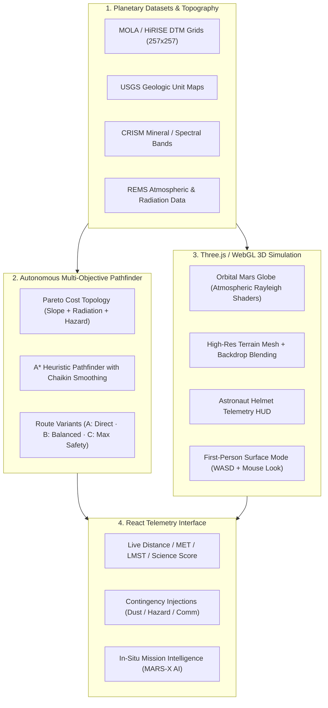

# 🔴 MARS-X — Autonomous Human Marswalk Mission Planner & Traversal Simulator

[](https://www.spaceappschallenge.org/)
[](https://react.dev/)
[](https://threejs.org/)
[](https://vitejs.dev/)
[](https://www.khronos.org/webgl/)
[](LICENSE)

> **Next-generation Extravehicular Activity (EVA) autonomous route planning, real-time planetary traversal telemetry, and photorealistic 3D terrain simulation for human exploration of Mars.**

---

## 🌌 Overview

**MARS-X** is an autonomous mission planning platform and interactive 3D simulation console engineered for future human astronauts undertaking Extravehicular Activities (EVAs) on the Martian surface.

Synthesizing orbital telemetry inspired by NASA Planetary Data System (PDS) and USGS Astrogeology maps (MOLA elevation models, HiRISE stereo DTMs, CRISM spectral mineralogy, and THEMIS thermal inertia), MARS-X delivers:
- **Global-to-Local Precision:** Seamless orbital targeting transitions from a physically accurate 3D Martian globe down to 5 km × 5 km high-resolution surface Digital Elevation Models (DEM).
- **Autonomous Multi-Objective Pathfinding:** An A* search engine operating over a weighted Pareto cost topology that continuously balances terrain slope gradient hazards, radiation shielding, thermal stress, communication repeater line-of-sight, and scientific sample return.
- **First-Person Astronaut Surface Mode:** 60 FPS eye-level traversal simulator featuring an interactive helmet Heads-Up Display (HUD) with telemetry compass, attitude pitch ladder, rangefinder, vital signs monitoring, and hazard proximity radar.
- **Dynamic Contingency Injections:** Real-time in-situ rerouting under sudden atmospheric dust storm fronts, communication dropouts, rockfall hazards, and astronaut fatigue.

---

## 🧭 Key Capabilities & System Architecture



---

## 🪐 Six High-Fidelity Exploration Regions

MARS-X features six fully modeled Martian regions, each with calibrated radiometric albedo, heightfield geology, environmental constraints, science targets, and hazard zones:

| Region | Coordinates | Base Elevation | Primary Geology | Key Scientific Targets |
|---|---|---|---|---|
| **Gale Crater**<br>*(Mount Sharp NW)* | 5.4°S, 137.8°E | -4,450 m | Lacustrine mudstones, hematite ridge, sulfate mounds | Layered phyllosilicates, lakebed mudstone core, basaltic sand dunes |
| **Jezero Crater**<br>*(Western Delta)* | 18.4°N, 77.5°E | -2,500 m | Ancient fluvial river delta, carbonate basement | River delta breach channel, Séítah olivine-carbonate cumulate, delta bottomset silts |
| **Olympus Mons**<br>*(Basal Scarp)* | 18.6°N, 133.8°W | +1,200 m | Colossal columnar basalt cliff scarp (>55°), lava tubes | Collapsed lava tube skylight cavern, sheer 8 km scarp, fumarolic sulfur cone |
| **Valles Marineris**<br>*(Candor Chasma)* | 14.0°S, 59.0°W | -3,800 m | Deep tectonic canyon walls, layered sulfate plateau | Landslide megabreccia apron, hydrothermal opalline silica veins, fault wall basalt |
| **Hellas Planitia**<br>*(Cryogenic Basin)* | 42.4°S, 70.5°E | -7,150 m | Lowest elevation on Mars, permafrost polygons | Subsurface water-ice wedges, glacial outwash smectite basin, cryo-cone frost pingo |
| **Elysium Planitia**<br>*(Cerberus Fossae)* | 4.5°N, 135.6°E | -2,800 m | Youngest volcanic plain, linear tectonic graben fissure | 40 m vertical Cerberus graben chasm, rootless pyroclastic cone, seismic bedrock plate |

---

## ⚡ Autonomous Route Planning Engine

The autonomous pathfinding core computes candidate trajectories between the Habitat (`HAB-1`), target points of interest, and return egress using a cost function calibrated to Martian human biomechanics:

$$\text{Cost}(k, m) = d \cdot \left(1 + w_{\text{slope}} \cdot \left(\frac{\theta}{10}\right)^2 + w_{\text{haz}} \cdot H(m) \cdot 8\right)$$

Where:
- $d$: 3D Euclidean distance traversed across the local terrain mesh.
- $\theta$: Local slope angle in degrees; slopes exceeding the maximum traversable threshold ($\theta > 30^\circ$) trigger hard cell blockages.
- $H(m)$: Integrated hazard potential (unconsolidated aeolian sand traps, loose scree, cliff drop-offs, and unshielded radiation zones).
- $w_{\text{slope}}, w_{\text{haz}}$: Strategic weights determining the variant profile.

### Strategic Route Variants
1. **Route A (Direct Corridor):** Time-optimal trajectory targeting the top-2 highest yield science targets. Minimizes mission elapsed time and oxygen consumption.
2. **Route B (Balanced Safe):** Multi-objective optimal traverse reaching all targets while maintaining strict clearance margins around hazardous zones.
3. **Route C (Max Safety):** Ultra-conservative route avoiding any terrain in proximity to Level 3 or 4 hazards (cliffs, deep ravines, unstable scree).

---

## 🧑‍🚀 Astronaut First-Person Surface Mode & Telemetry HUD

Clicking **Enter Surface Mode** descends the camera from aerial orbit directly into an astronaut's eye-level perspective ($1.75\text{ m}$ standing human height):

- **Surface Navigation:**
  - `W` / `A` / `S` / `D` — Walk forward, left, backward, right.
  - `Shift` — Fast traverse mode (pressurized rover sprint).
  - `Mouse Drag` — Eye-level look and pitch control.
  - `Esc` — Disengage surface mode and ascend back to aerial overview.
- **Heads-Up Display (HUD):**
  - **Compass Ribbon:** 360° heading tape with cardinal readouts.
  - **Attitude Pitch Ladder:** Visualizes ground slope gradient and vestibular orientation.
  - **Mission Clock:** Real-time tracking of Local Mean Solar Time (LMST) and Mission Elapsed Time (MET).
  - **Vital Signs Monitoring:** Real-time readouts for suit pressure ($34.5\text{ kPa}$ nominal), $\text{O}_2$ remaining, suit battery life, core temperature, and pulse rate.
  - **Proximity Radar:** Detects nearby hazards with automated rangefinder countdown and critical warnings.

---

## 🔬 Multi-Spectral Data Overlays

MARS-X features real-time GPU shader overlays rendered using custom GLSL shaders with Nyquist anti-aliasing:

- **Elevation (Topography):** Dynamic 25m minor contour lines and 100m index contour lines styled after scientific isoline vector maps, with frequency-dependent anti-aliasing to prevent grazing-angle whiteout.
- **Geological Units:** USGS-style stratigraphy classification with interactive color legends identifying crater floor basalt, lacustrine deposits, and active dunes.
- **Mineral / Spectral:** CRISM-inspired absorption indices highlighting phyllosilicates (clay), crystalline hematite, and hydrated sulfates.
- **Thermal Inertia:** Surface diurnal thermal variations highlighting bedrock versus loose insulating dust.
- **Radiation Flux:** Real-time calculated cosmic ray and solar particle surface dose rates.

---

## 🛠️ Tech Stack & Architecture

- **Frontend & UI Framework:** [React 19](https://react.dev/) + Modern Web Components
- **3D Graphics Engine:** [Three.js](https://threejs.org/) (r173) with WebGL 2.0
- **Post-Processing:** `EffectComposer`, `UnrealBloomPass`, `OutputPass`, ACES Filmic Tone Mapping
- **Animation & Transitions:** [GSAP](https://greensock.com/gsap/) (GreenSock Animation Platform)
- **Styling:** Modular CSS3 with Sci-Fi Glassmorphism Telemetry HUD Design (`Chakra Petch`, `JetBrains Mono`)
- **Build Tool:** [Vite 6](https://vitejs.dev/) (lightning-fast HMR and optimized production bundling)

---

## 🚀 Getting Started

### Prerequisites
- Node.js (v18.0.0 or higher recommended)
- npm or yarn

### Installation
```bash
# Clone the repository
git clone https://github.com/mithumohan00-ship-it/mars-x.git

# Navigate into the project directory
cd mars-x

# Install dependencies
npm install
```

### Development Server
```bash
# Launch the local development server with Hot Module Replacement
npm run dev
```
Open [http://localhost:3000](http://localhost:3000) in your browser.

### Production Build
```bash
# Create an optimized production build in /dist
npm run build

# Preview the production build locally
npm run preview
```

---

## 📡 Data Sources & Scientific References

1. **NASA Planetary Data System (PDS):**
   - Geosciences Node: Mars Global Surveyor (MGS) Mars Orbiter Laser Altimeter (MOLA) MEGDR Digital Elevation Models.
   - Imaging Node: Mars Reconnaissance Orbiter (MRO) High Resolution Imaging Science Experiment (HiRISE) Stereo Digital Terrain Models (DTMs).
2. **USGS Astrogeology Science Center:**
   - Unified Geologic Map of Mars (USGS Scientific Investigations Map 3292).
3. **NASA Mars 2020 & MSL Science Teams:**
   - Rover Environmental Monitoring Station (REMS) and Radiation Assessment Detector (RAD) reduced environmental datasets.

---

## 📄 License

This project is licensed under the [MIT License](LICENSE) — see the LICENSE file for details.

---

<p align="center">
  <b>MARS-X</b> · Developed for the NASA Space Apps Challenge · Advancing Human Exploration of the Red Planet.
</p>
